  

Sou analista de sistemas e desenvolvo ferramentas para Windows e aplicações web. Também trabalho com redes, servidores e automação de rotinas de TI.

## Projetos em destaque

- **[WSystemX](https://github.com/FelipeWelter/WSystemX-Releases)** — utilitário de monitoramento e diagnóstico para Windows, desenvolvido em C# com .NET e WPF.
- **Portal de Monitoramento** — painel para acompanhar serviços HTTP/HTTPS, disponibilidade via ping e estado de contêineres Docker.

## Tecnologias

**Desenvolvimento** · C# · .NET · WPF · Python · Flask  
**Infraestrutura** · Linux · Windows Server · Docker · Redes TCP/IP
